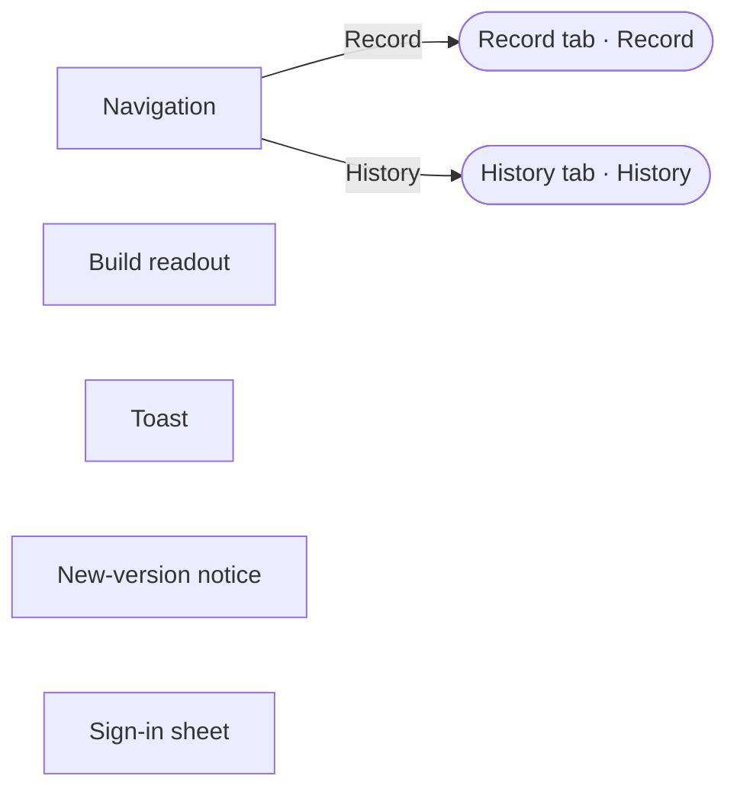
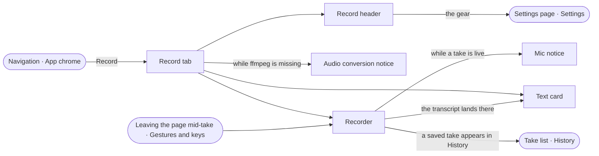
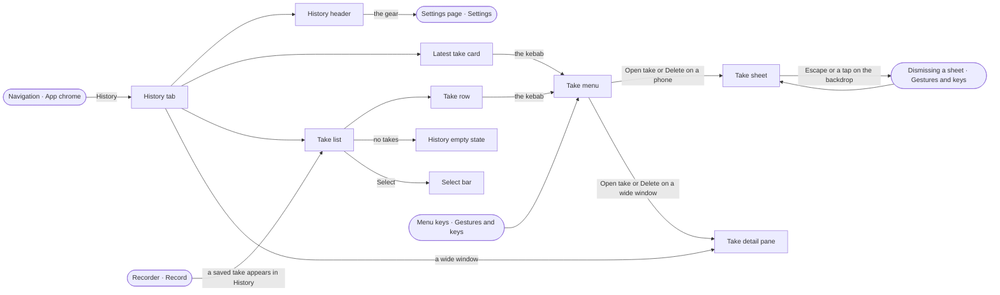
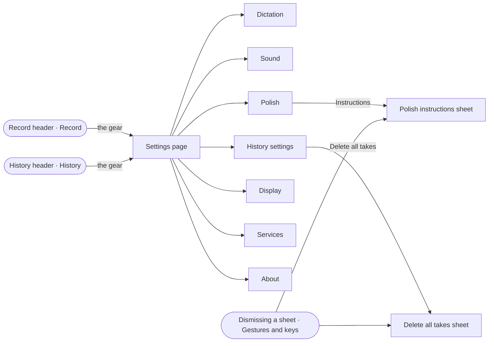
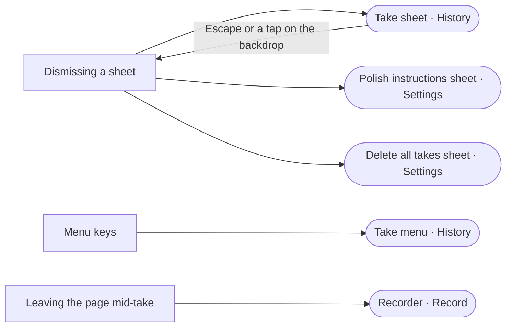

<!-- Generated from docs/ux-surfaces.yaml by scripts/ux_surface_map.py. Do not edit: change the map and re-run. -->

# UX surface map: voice-transcriber

Every surface a person can reach in this app, each under a stable id that its root element carries as `data-surface`. Each area has a diagram of how its surfaces connect; a rounded node is a surface in another area.

The checklist of everything a person can see and do in the voice-transcriber web app (the PWA served on :8443): every tab, sheet, dialog, menu, state and gesture, with how it is reached, what is on it, what each control does and the decision behind it where one exists. [Web app usage](webapp-usage.md) tells the story of the screens in prose; this page is the exhaustive index, so a layout change can check every surface and not only the ones a reviewer happens to open.

**Keeping it true.** A change that adds, removes, renames or reshapes a user-visible surface updates its entry in `docs/ux-surfaces.yaml` in the same change and regenerates this page with `python scripts/ux_surface_map.py`; this page is never edited by hand. The rule is in `CLAUDE.md`.

**Ids.** `<area>.<surface>`, lowercase words joined by `.` or `-`, the same form the e2e `surface(page, "<id>")` hook takes. The surface's root element carries the same id as `data-surface`; the vendored row menu builds its own element, so its call site stamps the id on what `attach` returns. `scripts/ux_surface_ratchet.py` fails a surface root without an id, an id without an entry, an entry no element carries, an id on two roots, a link to an id with no entry and a page that is not what the map generates. It reads markup and JS, so the entries marked `none` are held by this map and the e2e walk alone.

## Ground rules

**Two destinations, one gear.** The nav is Record and History. Settings is the header gear on both panes, one tap from every tab, and is not a tab. Every sheet and the Settings page are native `<dialog>` elements over the current tab, so closing one returns to where the person was.

**Layout bands** (the same markup, two placements):

| Band | Condition | Nav | History take |
| --- | --- | --- | --- |
| Phone and narrow window | any touch screen, or a mouse below 1100px | floating bottom pill (an inline tab bar on a mouse below 1100px) | a modal sheet over the list |
| Wide | 1100px and up with a mouse | left rail | a detail pane beside the list that always shows a take |

**Where state lives.** Theme and text size are per-device (`localStorage`). Language, Translate and the two recorder switches (Append, Incognito) are per-session choices that are not saved. Every other Settings choice saves to the server as it changes; there is no Save button.

**Gating.** Send to task-os (a menu row and its Settings switch) is off until Settings turns it on. Share shows only in a browser that has a share sheet. Redo shows only for a take whose audio is still kept. Polish is disabled with its reason when the LLM hub is down.

**Who the viewer is.** On the PC itself (loopback) the app opens with no credential. Any other device signs in through the vendored sign-in sheet.

Walked 2026-11-18 against build `781ad17`, at widths 390, 1280, themes light, dark.

## Areas

| Area | Surfaces |
|---|---|
| [App chrome](#app-chrome) | 5 |
| [Record](#record) | 6 |
| [History](#history) | 10 |
| [Settings](#settings) | 10 |
| [Gestures and keys](#gestures-and-keys) | 3 |

## App chrome

What every tab shares, and the two surfaces the vendored components build.

### `app.nav` Navigation

- **Root:** `data-surface`
- **Reach:** always on screen
- **Holds:** Record and History tabs (the vendored fleet nav)
- **Does:**
  - a tap switches the tab and remembers it for the next visit
  - opening History refreshes the list
- **Phone:** a floating pill at the bottom, hidden under a modal
- **Desktop:** a left rail from 1100px with a mouse, an inline tab bar below that
- **Why:** Settings is never a tab, so the nav stays two destinations.
- **Leads to:**
  - [Record tab](#recordpane-record-tab) (Record)
  - [History tab](#historypane-history-tab) (History)

### `app.footer` Build readout

- **Root:** `data-surface`
- **Reach:** the end of every tab
- **Holds:** the build sha and build time of the code this device loaded
- **States:** empty when the version call fails

### `app.toast` Toast

- **Root:** `data-surface`
- **Reach:** after a copy, a save, a redo, a polish, a send to task-os, a delete or any failed call
- **Holds:** one short line, neutral or tinted for an error
- **Does:** dismisses itself; never takes focus
- **Why:** a user-initiated result is a toast, a passive status is a line beside the surface it describes.

### `app.update-banner` New-version notice

- **Root:** `data-surface`
- **Holds:**
  - (stamped by the vendored build-watch component itself)
  - a banner offering Reload when the server moved to a newer build while the page stayed open
- **Does:**
  - Reload reloads the page, only ever on the person's tap
  - dismiss keeps it down until the server moves to yet another build

### `shared.login` Sign-in sheet

- **Root:** `data-surface`
- **Reach:** any call the server answers with 401 from a device that is not the PC
- **Holds:**
  - (stamped by the vendored sign-in component itself)
  - a password field and its submit
- **States:**
  - Escape does not dismiss it: a closed gate is not an unlocked app
  - wrong password: the sheet says so and stays open
  - locked out after repeated wrong passwords: it says to wait

## Record

The default tab. One circle, the mode switches and one Text card.

### `record.pane` Record tab

- **Root:** `data-surface`
- **Reach:**
  - the Record tab
  - the page's first screen
- **Holds:** the header, the recorder card, the Text card
- **Leads to:**
  - [Record header](#recordheader-record-header)
  - [Audio conversion notice](#recordffmpeg-notice-audio-conversion-notice) (while ffmpeg is missing)
  - [Recorder](#recordrecorder-recorder)
  - [Text card](#recordtext-card-text-card)

### `record.header` Record header

- **Root:** `data-surface`
- **Holds:** Record title, one live context line, the theme toggle, the Settings gear
- **Does:**
  - the theme toggle flips light and dark and remembers it
  - the gear opens Settings
- **States:**
  - the language, as a plain fact
  - 'Spanish to English' when Translate is on
  - Incognito: not saved, while Incognito is on
  - Polish unavailable, when the hub is down
  - Transcription offline, when neither route can transcribe
- **Leads to:** [Settings page](#settingspage-settings-page) (the gear)

### `record.ffmpeg-notice` Audio conversion notice

- **Root:** `data-surface`
- **Reach:** shown by itself while the server reports ffmpeg missing
- **Holds:**
  - 'Audio conversion unavailable' and what to do about it
  - the winget install command in a listing, with a copy button
  - Check again
- **Does:**
  - the copy button puts the command on the clipboard; the app never runs it
  - Check again looks for ffmpeg again, so a fresh install is found without a restart
- **States:**
  - hidden while ffmpeg is found, and until the first status answer
  - unchanged when a status poll fails or the probe has not answered
- **Why:** a missing ffmpeg is said up front with its one fix, not after a failed take.

### `record.recorder` Recorder

- **Root:** `data-surface`
- **Holds:**
  - the record circle
  - Continue this text beside it, only after a take was finalised in the background
  - the take timer
  - the status line
  - the mic notice slot
  - the Append and Incognito switches
- **Does:**
  - Record starts a take, Stop finishes it
  - Continue this text starts a new take that adds to the text on screen
  - Append makes the next take add to the text instead of replacing it
  - Incognito keeps the next take out of History
- **States:**
  - idle: 'Tap to start'
  - starting: 'Requesting mic' or 'Reusing mic'
  - recording: the circle is Stop and the timer runs, the screen wake lock is held
  - silence auto-stop pending: 'Auto-stop on silence, keep talking to cancel'
  - finishing: the circle is a spinner and the status says Uploading or Finalising upload
  - paused while away: the page was hidden mid-take and the take is being finalised
  - failed: 'Failed, recording is still on the PC, see History' with a toast
  - mic refused or unavailable: a toast names the reason
- **Why:** one circle in four states keeps the tab's single primary action in one place.
- **Leads to:**
  - [Mic notice](#recordmic-notice-mic-notice) (while a take is live)
  - [Text card](#recordtext-card-text-card) (the transcript lands there)
  - [Take list](#historytake-list-take-list) (a saved take appears in History)

### `record.mic-notice` Mic notice

- **Root:** `data-surface`
- **Reach:** starts with a take and ends with it
- **Holds:**
  - (built by the vendored mic-notice component)
  - the input's name, a level strip and a warning when the input is silent
- **States:**
  - hidden when no take is live
  - silent mic: the warning shows after the first seconds

### `record.text-card` Text card

- **Root:** `data-surface`
- **Holds:**
  - the Transcript and Polished switch, shown once a polish exists
  - one editable text box at a time; both versions keep their edits
  - a meta line: when, words and length for a take, the polish style for the Polished version
  - the verb row: Copy, Polish, Save, Clear
- **Does:**
  - Copy copies the version shown
  - Polish sends the text to the LLM hub with the chosen model and style, then shows the Polished version
  - Save puts text History does not hold yet (a paste) into History
  - Clear empties the text and starts a fresh session
  - pasting or typing fills the card; Polish then works on the paste
- **States:**
  - empty: the placeholder, and no verb row
  - live text while recording: 'Live text, refined when you stop'
  - polishing: the button says Polishing and is disabled
  - hub down: the button says Polish unavailable and is disabled
  - Save is hidden once History holds the text
- **Why:** the card is one text in two versions, so Copy never has to ask which one.

## History

The list of saved takes, each reachable in one tap; the take sheet (phone) or detail pane (wide) holds everything else about one take.

### `history.pane` History tab

- **Root:** `data-surface`
- **Reach:** the History tab
- **Holds:** the header, the Latest take card, the day-grouped list, Show older takes, the take detail pane on a wide window
- **Leads to:**
  - [History header](#historyheader-history-header)
  - [Latest take card](#historylatest-card-latest-take-card)
  - [Take list](#historytake-list-take-list)
  - [Take detail pane](#historytake-detail-take-detail-pane) (a wide window)

### `history.header` History header

- **Root:** `data-surface`
- **Holds:** History title, one live context line, the theme toggle, the Settings gear
- **States:**
  - '15 takes, audio kept 30 days'
  - 'N selected' while Select mode is on
  - Couldn't load history, when the list call fails
- **Leads to:** [Settings page](#settingspage-settings-page) (the gear)

### `history.latest-card` Latest take card

- **Root:** `data-surface`
- **Holds:**
  - the newest take: when, text, words and length
  - Copy
  - the take menu kebab
  - today's numbers: takes, words per minute and time saved
- **Does:** Copy copies the full text of the take
- **States:**
  - hidden while there are no takes
  - hidden in Select mode, where the newest take is a row
  - 'No takes yet today' when nothing was recorded today
- **Leads to:** [Take menu](#historytake-menu-take-menu) (the kebab)

### `history.take-list` Take list

- **Root:** `data-surface`
- **Holds:**
  - one overline per day with its count and a card of take rows
  - Select, on the first day's overline
  - Show older takes, while the server reports more
- **Does:**
  - Select enters Select mode
  - Show older takes appends the next ten
- **States:** empty: the empty state
- **Leads to:**
  - [Take row](#historytake-row-take-row)
  - [History empty state](#historyempty-history-empty-state) (no takes)
  - [Select bar](#historyselect-bar-select-bar) (Select)

### `history.take-row` Take row

- **Root:** `data-surface`
- **Holds:**
  - the time, one line of text, words and length, the source, a language chip when not the default
  - the kebab
- **Does:**
  - a tap copies the full text and shows Copied on the row
  - in Select mode a tap ticks the row instead
- **States:**
  - the open row is marked on a wide window
  - picked: ticked in Select mode
  - no kebab in Select mode
- **Why:** a row copies on tap because Copy is what the person does most; everything else is in the kebab.
- **Leads to:** [Take menu](#historytake-menu-take-menu) (the kebab)

### `history.empty` History empty state

- **Root:** `data-surface`
- **Reach:** no takes yet, or every take deleted
- **Holds:** 'No takes yet, record something'

### `history.select-bar` Select bar

- **Root:** `data-surface`
- **Reach:** Select on the first day's overline
- **Holds:**
  - the count, 'N takes, oldest first'
  - Cancel
  - Copy
- **Does:**
  - Copy joins the picked takes oldest first, a blank line between, and leaves Select mode
  - Cancel leaves Select mode
- **States:**
  - Copy is disabled until a take is picked
  - a refresh also leaves Select mode

### `history.take-menu` Take menu

- **Root:** `data-surface`
- **Reach:** the kebab on a row or on the Latest take card
- **Holds:**
  - Open take
  - Share, only where the browser has a share sheet
  - Copy as Markdown
  - Send to task-os, only once Settings turns it on
  - Refresh
  - Delete, last and in danger colour
- **Does:**
  - Open take opens the take sheet, or the detail pane on a wide window
  - Share opens the share sheet with the full text, falling back to the clipboard
  - Copy as Markdown copies the take as one bullet
  - Send to task-os makes the take an Inbox task, once; a second tap says it is already there
  - Refresh reloads the list
  - Delete opens the take with its Delete already armed
- **Why:** a delete is never one stray tap, so the menu hands over to the take's own two-tap confirm.
- **Leads to:**
  - [Take sheet](#historytake-sheet-take-sheet) (Open take or Delete on a phone)
  - [Take detail pane](#historytake-detail-take-detail-pane) (Open take or Delete on a wide window)

### `history.take-sheet` Take sheet

- **Root:** `data-surface`
- **Reach:** Open take or Delete in the take menu on a phone or narrow window
- **Holds:**
  - the take's date as the title and a close button
  - the full text
  - Copy
  - Redo transcription
  - Length, Language, Source, Served by
  - Delete take
- **Does:**
  - Copy copies the full text
  - Redo transcription sends the saved audio through again and puts the result in the Text card
  - Delete take arms on the first tap ('Tap again to delete') and deletes on the second
- **States:**
  - the preview shows at once and the full text replaces it when it arrives
  - Redo is hidden once the audio is past its retention
  - armed delete disarms after four seconds and when the sheet closes
  - facts a take predates say 'Not recorded'
- **Why:** the browser's own confirm is never used, so the second tap on the button is the confirmation.
- **Leads to:** [Dismissing a sheet](#gesturesdismiss-dismissing-a-sheet) (Escape or a tap on the backdrop)

### `history.take-detail` Take detail pane

- **Root:** `data-surface`
- **Reach:** a wide window: the pane beside the list, always showing a take (the picked one, else the newest)
- **Holds:** the same card as the take sheet: title, close, text, Copy, Redo transcription, the facts, Delete take
- **Does:** the close button hides the pane until a take is opened again
- **States:**
  - empty list: the pane is hidden
  - narrowing the window below the wide band moves the card back into the sheet
- **Phone:** not shown
- **Why:** one card moves between the sheet and the pane, so there is one renderer and one set of handlers.

## Settings

A full page opened by the header gear. Rows hold a choice inline and save as they change.

### `settings.page` Settings page

- **Root:** `data-surface`
- **Reach:** the gear in either header
- **Holds:**
  - the title and a close button
  - the seven groups: Dictation, Sound, Polish, History, Display, Services, About
- **Does:**
  - the close button, Escape and the backdrop return to the tab underneath
  - opening it refreshes the Services values
- **States:** a setting that fails to save shows a toast and keeps the old value
- **Why:** Settings is a modal page over the tab, so the tab and its nav state are untouched.
- **Leads to:**
  - [Dictation](#settingsdictation-dictation)
  - [Sound](#settingssound-sound)
  - [Polish](#settingspolish-polish)
  - [History settings](#settingshistory-history-settings)
  - [Display](#settingsdisplay-display)
  - [Services](#settingsservices-services)
  - [About](#settingsabout-about)

### `settings.dictation` Dictation

- **Root:** `data-surface`
- **Holds:**
  - Language, a select
  - Translate to English, a switch
  - Microphone, a select
  - Prefer the built-in mic, a switch
- **Does:**
  - Language and Translate apply to the next take and are not saved
  - Microphone and Prefer the built-in mic save and drop the cached mic stream, so the next take re-opens the input
- **States:** Microphone lists System default plus every input the browser names
- **Why:** Language and Translate are per-session choices, so a different dictation language never sticks.

### `settings.sound` Sound

- **Root:** `data-surface`
- **Holds:**
  - Boost quiet audio, a switch
  - Boost amount, a number in dB
  - Stop after silence, a switch
  - Silence length, a number in seconds
- **Does:**
  - Boost makes a quiet recording louder before it is transcribed
  - Stop after silence ends the take after the silence length, with a short notice first

### `settings.polish` Polish

- **Root:** `data-surface`
- **Holds:**
  - Model, a select
  - Style, a select
  - Instructions, a row that opens the prompt sheet
- **Does:** Model and Style choose what Polish sends
- **Leads to:** [Polish instructions sheet](#settingsprompt-sheet-polish-instructions-sheet) (Instructions)

### `settings.history` History settings

- **Root:** `data-surface`
- **Holds:**
  - Keep audio for, a number of days
  - Delete all takes
  - Send to task-os, a switch
- **Does:**
  - Keep audio for sets how long the audio is kept; the text stays
  - Delete all takes opens its confirmation sheet
  - Send to task-os adds that row to the take menu
- **Leads to:** [Delete all takes sheet](#settingsdelete-all-sheet-delete-all-takes-sheet) (Delete all takes)

### `settings.display` Display

- **Root:** `data-surface`
- **Holds:** Text size, Small, Default or Large
- **Does:** a tap applies at once and is remembered on this device

### `settings.services` Services

- **Root:** `data-surface`
- **Holds:** Transcription, Local fallback, Polish, Audio conversion, each with its state in words
- **States:**
  - Ready, Not running, Not reachable, Missing, On the local fallback, Down
  - Unknown while a probe has not answered or the poll failed
  - only a down probe is tinted

### `settings.about` About

- **Root:** `data-surface`
- **Holds:** Build, the sha and time of the loaded code
- **States:** Unavailable when the version call fails

### `settings.prompt-sheet` Polish instructions sheet

- **Root:** `data-surface`
- **Reach:** Settings, Polish, Instructions
- **Holds:**
  - a note naming the style
  - the prompt that is sent with the text, read-only
  - Done
- **Does:** Done, the close button, Escape and the backdrop close it
- **Why:** the prompt is long, so it sits in a sheet instead of a permanent box.

### `settings.delete-all-sheet` Delete all takes sheet

- **Root:** `data-surface`
- **Reach:** Settings, History, Delete all takes
- **Holds:**
  - the warning that every saved recording and transcript is removed and cannot be undone
  - Delete all takes
- **Does:**
  - Delete all takes removes them, toasts how many, and refreshes History
  - the close button, Escape and the backdrop cancel
- **Why:** the confirmation is a sheet, never the browser's own dialog.

## Gestures and keys

Inputs that are not elements of their own.

### `gestures.dismiss` Dismissing a sheet

- **Root:** none — an input handled by every dialog, with no element of its own.
- **Reach:** Escape, the close button, or a tap on the backdrop outside the card
- **Does:** closes the take sheet, the prompt sheet, the delete-all sheet and the Settings page, and returns to the tab underneath
- **Leads to:**
  - [Take sheet](#historytake-sheet-take-sheet)
  - [Polish instructions sheet](#settingsprompt-sheet-polish-instructions-sheet)
  - [Delete all takes sheet](#settingsdelete-all-sheet-delete-all-takes-sheet)

### `gestures.menu-keys` Menu keys

- **Root:** none — keyboard paths inside the take menu, with no element of their own.
- **Reach:**
  - Enter, Space or a tap on a kebab opens the menu on its first item
  - ArrowDown and ArrowUp on the kebab open it on the first or last item
- **Does:**
  - ArrowDown, ArrowUp, Home and End move through the rows, wrapping
  - Escape, choosing a row and Tab close the menu and return focus to the kebab
- **Leads to:** [Take menu](#historytake-menu-take-menu)

### `gestures.visibility` Leaving the page mid-take

- **Root:** none — the page being hidden, with no element of its own.
- **Reach:** switching apps or locking the screen while recording
- **Does:**
  - the take is finalised so it is saved, then the status says it paused while away
  - coming back re-takes the screen wake lock if a take is still live
  - an idle page releases the mic so the phone's recording indicator goes off
- **Leads to:** [Recorder](#recordrecorder-recorder)

## Link index

| From | Via | To |
|---|---|---|
| [Navigation](#appnav-navigation) | Record | [Record tab](#recordpane-record-tab) |
| [Navigation](#appnav-navigation) | History | [History tab](#historypane-history-tab) |
| [Record tab](#recordpane-record-tab) |  | [Record header](#recordheader-record-header) |
| [Record tab](#recordpane-record-tab) | while ffmpeg is missing | [Audio conversion notice](#recordffmpeg-notice-audio-conversion-notice) |
| [Record tab](#recordpane-record-tab) |  | [Recorder](#recordrecorder-recorder) |
| [Record tab](#recordpane-record-tab) |  | [Text card](#recordtext-card-text-card) |
| [Record header](#recordheader-record-header) | the gear | [Settings page](#settingspage-settings-page) |
| [Recorder](#recordrecorder-recorder) | while a take is live | [Mic notice](#recordmic-notice-mic-notice) |
| [Recorder](#recordrecorder-recorder) | the transcript lands there | [Text card](#recordtext-card-text-card) |
| [Recorder](#recordrecorder-recorder) | a saved take appears in History | [Take list](#historytake-list-take-list) |
| [History tab](#historypane-history-tab) |  | [History header](#historyheader-history-header) |
| [History tab](#historypane-history-tab) |  | [Latest take card](#historylatest-card-latest-take-card) |
| [History tab](#historypane-history-tab) |  | [Take list](#historytake-list-take-list) |
| [History tab](#historypane-history-tab) | a wide window | [Take detail pane](#historytake-detail-take-detail-pane) |
| [History header](#historyheader-history-header) | the gear | [Settings page](#settingspage-settings-page) |
| [Latest take card](#historylatest-card-latest-take-card) | the kebab | [Take menu](#historytake-menu-take-menu) |
| [Take list](#historytake-list-take-list) |  | [Take row](#historytake-row-take-row) |
| [Take list](#historytake-list-take-list) | no takes | [History empty state](#historyempty-history-empty-state) |
| [Take list](#historytake-list-take-list) | Select | [Select bar](#historyselect-bar-select-bar) |
| [Take row](#historytake-row-take-row) | the kebab | [Take menu](#historytake-menu-take-menu) |
| [Take menu](#historytake-menu-take-menu) | Open take or Delete on a phone | [Take sheet](#historytake-sheet-take-sheet) |
| [Take menu](#historytake-menu-take-menu) | Open take or Delete on a wide window | [Take detail pane](#historytake-detail-take-detail-pane) |
| [Take sheet](#historytake-sheet-take-sheet) | Escape or a tap on the backdrop | [Dismissing a sheet](#gesturesdismiss-dismissing-a-sheet) |
| [Settings page](#settingspage-settings-page) |  | [Dictation](#settingsdictation-dictation) |
| [Settings page](#settingspage-settings-page) |  | [Sound](#settingssound-sound) |
| [Settings page](#settingspage-settings-page) |  | [Polish](#settingspolish-polish) |
| [Settings page](#settingspage-settings-page) |  | [History settings](#settingshistory-history-settings) |
| [Settings page](#settingspage-settings-page) |  | [Display](#settingsdisplay-display) |
| [Settings page](#settingspage-settings-page) |  | [Services](#settingsservices-services) |
| [Settings page](#settingspage-settings-page) |  | [About](#settingsabout-about) |
| [Polish](#settingspolish-polish) | Instructions | [Polish instructions sheet](#settingsprompt-sheet-polish-instructions-sheet) |
| [History settings](#settingshistory-history-settings) | Delete all takes | [Delete all takes sheet](#settingsdelete-all-sheet-delete-all-takes-sheet) |
| [Dismissing a sheet](#gesturesdismiss-dismissing-a-sheet) |  | [Take sheet](#historytake-sheet-take-sheet) |
| [Dismissing a sheet](#gesturesdismiss-dismissing-a-sheet) |  | [Polish instructions sheet](#settingsprompt-sheet-polish-instructions-sheet) |
| [Dismissing a sheet](#gesturesdismiss-dismissing-a-sheet) |  | [Delete all takes sheet](#settingsdelete-all-sheet-delete-all-takes-sheet) |
| [Menu keys](#gesturesmenu-keys-menu-keys) |  | [Take menu](#historytake-menu-take-menu) |
| [Leaving the page mid-take](#gesturesvisibility-leaving-the-page-mid-take) |  | [Recorder](#recordrecorder-recorder) |
